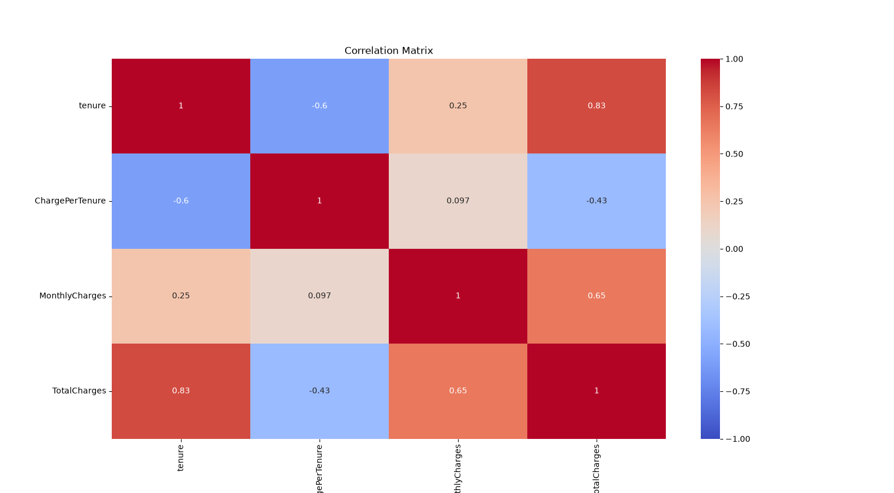
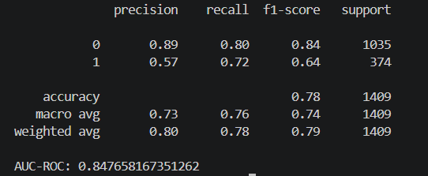
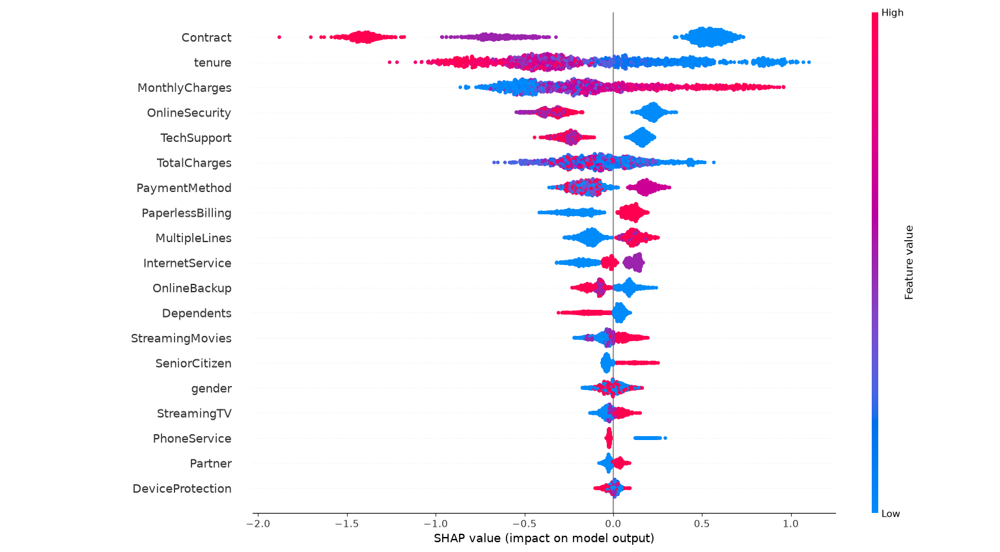
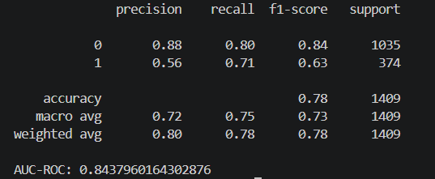
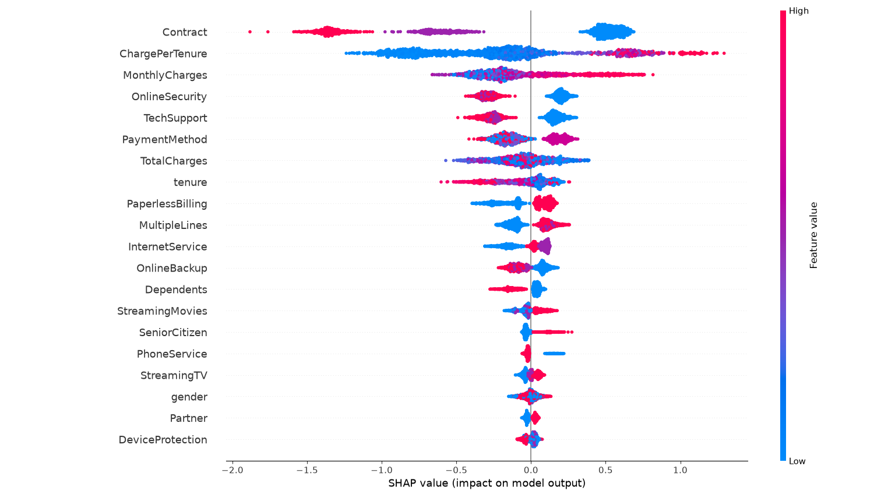
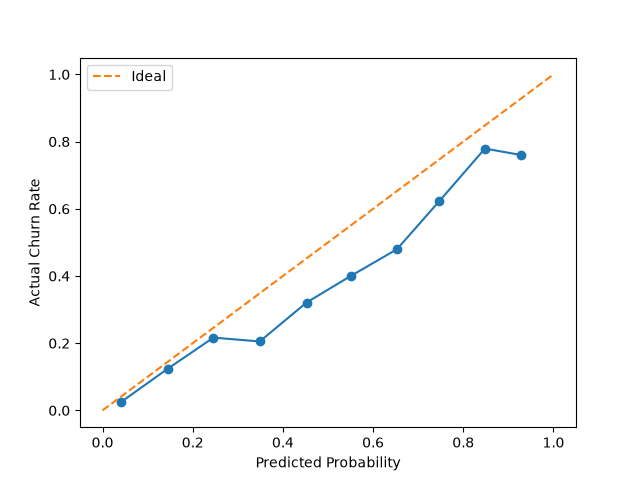

# Churn-Copilot

<video controls src="assets/demo_churn.mp4" title="Title"></video>

A real-time churn copilot that predicts risk, explains why, and recommends action.

# Workflow
## How It Works


**Dataset (CSV)** — Built on the public Telco Customer Churn dataset (~7,000 customer records covering tenure, monthly charges, contract types, and service subscriptions). The data goes through cleaning and encoding (le_dict.pkl) before being split for model inference.

**Machine Learning** — I use an `XGBoost` model for this project not only because it's fast, but it also pairs natively with `shap.TreeExplainer` and its built-in L1/L2 leaf-weight regularization prevents overfitting on medium-sized structured datasets while keeping inference lightweight. From the processed customer data, this stage outputs two key signals: the churn probability and SHAP feature importance values to explain the prediction.

**LLM Reasoning** — Churn probability and SHAP feature importance are then processed by a local `qwen3:1.7b` model via Ollama. Instead of raw numbers, the model translates these technical signals into plain-language Reasoning (why the customer might leave) and an actionable Recommendation for the support agent.

**LLM-Behaviour** —  Receives each customer chat message and classifies their emotional state into one of six labels (Aggressive, Upset, Skeptical, Neutral, Receptive, or Happy).

## Installation
1. Clone the repository
    ```bash
    git clone https://github.com/JustinCode-Dev/churn-copilot.git
    cd churn-copilot
    ```
2. Create a virtual environment
   ```bash
   python -m venv venv
   venv\Scripts\activate  # Windows
   source venv/bin/activate  # macOS/Linux
   ```
3. Install dependencies
   ```bash
   pip install -r requirements.txt
   ```
4. Pull model ollama
   ```bash
   ollama pull qwen3:1.7b
   # make sure you already have the Ollama app installed and running
   ```
5. Run the app
    ```bash
    streamlit run app.py
    ```

# Model Evaluation & Feature Selection
Before I finalize the baseline XGBoost model, I test additional engineered features to see if they improve predictive power.
- **Experiment Result:** The new features do not improve the overall **AUC-ROC** or classification metrics, and they actually dilute the **SHAP importance** of core predictors like `tenure`.
-  **Decision:** I drop the extra features and keep the clean baseline feature set so the model remains accurate and produces sharp, trustworthy SHAP explanations for the LLM.



## Without `ChargePerTenure` Feature
| Model Evaluation (AUC-ROC & Classification Report) | SHAP Feature Importance |
| :---: | :---: |
|  |  |

## With `ChargePerTenure` Feature
| Model Evaluation (AUC-ROC & Classification Report) | SHAP Feature Importance |
| :---: | :---: |
|  |  |

# Scope & Limitations
- **Proof-of-Concept Architecture:** This repository demonstrates the end-to-end concept of an AI retention copilot rather than a production-ready application.

- **LLM hallucination & model switch:** I initially tried `Qwen2.5 1.5B`, but switched to `Qwen3 1.7B` after observing it would often hallucinate unsupported explanations and misattribute the direction of SHAP factors (e.g. labeling a feature that pushed toward churn as pushing toward staying), especially when multiple factors shared the same direction.

- **Simulated Customer Chat (`chat_simulator.py`):** Because real customer support chat logs are unavailable, a separate roleplay module simulates customer responses locally for demo purposes. The customer is hardcoded to index 10 of the test split (`data/X_test.csv`), generated during model training from the main dataset (`data/WA_Fn-UseC_-Telco-Customer-Churn.csv`). This keeps the demo's result consistent across runs rather than random.

- **Probability Calibration Gap** The model shows moderate overconfidence across the mid-to-upper probability range (roughly 0.25–0.9): predicted probabilities consistently overstate the actual churn rate in those bins, with the largest gap around 0.35–0.65. This likely reflects a genuinely ambiguous customer segment rather than a tuning failure. Correcting it (e.g. via Platt scaling) was intentionally left out of scope, since it would require re-validating the already-tuned recall/precision balance.



## File Structure

```text
churn-copilot/
├── assets/...    # Architecture diagram and evaluation plots
├── data/
│   ├── le_dict.pkl     # Saved label encoders
│   ├── WA_Fn-UseC_-Telco-Customer-Churn.csv
│   ├── X_test.csv
│   └── y_test.csv
├── model/
│   └── churn_model.pkl    # Trained XGBoost model
├── .gitignore
├── app.py
├── chat_simulator.py   # Local roleplay engine that simulates customer responses
├── LICENSE
├── llm.py     # Core ML/SHAP analysis and customer behaviour classifier
├── ml.py      # Model training and evaluation script
├── README.md
└── requirements.txt
```

# 📄 License

This project is licensed under the Apache License 2.0 - see the [LICENSE](LICENSE) file for details.